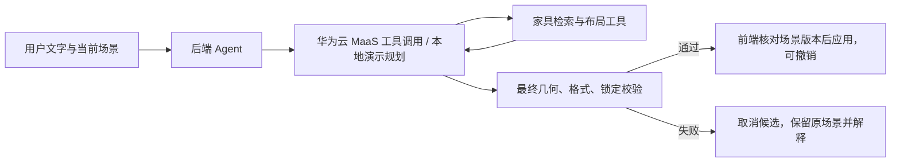

# 云筑家 Agent 初版

日期：2026-11-12。当前已完成可运行的后端工具流程和云模型适配器，默认演示模式；真实华为云模型调用尚待配置与联调。

2026-11-16状态更新：已新增DeepSeek界面配置并完成真实API联调，当前运行模式为cloud；华为云MaaS仍未联调。下文最初的演示说明保留作功能参考；当前验证结果及配置操作见[DeepSeek真实联调记录](DeepSeek真实联调记录.md)。

## 工作流程



家具目录由后端读取本地数据集，浏览器不提交商品价格表。模型没有任意文件、终端、网络检索和购买工具，只能使用下表中的项目工具。模型给出的工具名、参数、实例ID和商品ID都会重新校验。

| 工具 | 作用 |
| --- | --- |
| get_scene | 读取当前房间、家具、预算、几何问题 |
| search_furniture | 按类别、名称、最大宽度检索实际目录 |
| update_preferences | 设置预算上限与指定活动区 |
| lock_furniture | 锁定指定类别或实例；解锁须在界面手动操作 |
| replace_furniture | 同类别替换未锁定家具，清空旧估价 |
| add_furniture / remove_furniture | 增删目录中的落地家具，保护锁定项 |
| move_furniture | 移动或旋转未锁定家具 |
| generate_layout | 调用候选搜索生成留白、会客或阅读布局 |
| validate_layout | 检查边界、重叠、门扇、活动区和预算缺口 |

## 先体验演示流程

双击项目根目录的「启动云筑家.cmd」，使用启动器打开的地址。在聊天框输入：

> 预算8000元，保留沙发，茶几换小一点，留出活动区，生成阅读方案

结果中可以展开工具执行记录。演示模式只是固定规则选择同一套真实工具，能验证接口、候选、校验、场景应用链路，不代表具备大模型自由理解能力。底部三个布局偏好按钮仍直接调用本地布局算法。

## 配置真实模型

项目已提供本地`.env.local`；没有此文件时可复制`.env.example`。使用文本编辑器填写：

```dotenv
AGENT_MODE=cloud
AGENT_PROVIDER=Huawei Cloud MaaS
AGENT_API_URL=控制台提供的完整HTTPS地址，以/chat/completions结尾
AGENT_MODEL=控制台对应的模型参数值
AGENT_API_KEY=你创建的模型调用API_Key
```

API地址必须取自当前开通服务的调用说明；示例中国站MaaS V2地址为`https://api.modelarts-maas.com/v2/chat/completions`。不同区域和服务的地址、模型权限可能不同，不要把API Key管理页地址填入此处。模型需支持Function Calling；不能只凭模型能文字聊天就判断能使用这些工具。

保存配置后，刷新页面即可更新状态；配置在每次请求时读取，无须重启服务。页面显示「模型已配置」只说明必填项齐全，并不表示鉴权和模型权限已验证。发送一条简单需求，以返回的真实结果确认联调。

密钥只保存在后端读取的本地配置中，不放在`VITE_`变量、前端源码、浏览器存储或聊天内容中；`.env.local`已被Git忽略，也不属于静态文件服务目录。不要将本地配置与作品代码一起分享。

云端模式会发送文字需求、最近最多10条对话及本轮房间/家具信息；当前流程不上传照片或视频。模型鉴权失败、额度或速率限制、接口格式不兼容会明确显示错误，不会悄悄降级为演示模式。

## 接口与执行边界

`GET /api/agent/status`返回模式、提供商、模型名、是否配置完整，不返回密钥或接口地址。`POST /api/agent/chat`接收`message`、`plan`、`history`，返回`plan`、`changed`、`accepted`、`reply`、`trace`、预算和几何结果。

单次最多8轮模型请求、24次工具调用，90秒服务端期限；工具记录只展示工具和结果，不展示模型内部推理。最大30件家具；仅接受本机工作台请求。此后端尚未提供公网部署所需的账号、权限和租户隔离。

当前几何检查不包含完整路径可达性、专业施工规范、水电、承重等。未定价素材仍计为价格缺口；真实商品使用2026-11-10参考价和尺寸示意外观。模型不能补造价格、库存或商品映射。

## 验证方式

```text
pnpm test
pnpm build
node scripts/check-agent.mjs http://127.0.0.1:5174
node scripts/verify-assets.mjs http://127.0.0.1:5174
```

`check-agent.mjs`只在demo模式下运行，用实际本地目录验证HTTP调用、八步工具执行、锁定保留、小茶几替换和几何结果。单元测试中的模型响应使用测试替身，验证协议循环和错误处理，不属于真实华为云调用成功的证据。

官方依据：[Function Call](https://support.huaweicloud.com/model-call-maas/model-call-008.html)、[MaaS标准API V2](https://support.huaweicloud.com/model-call-maas/model-call-019.html)。实际可用模型和地址以你的服务控制台为准。

## 家居顾问 Agent v0.4（2026-11-16）

当前真实模型仍为本机已配置的 DeepSeek，新增的是本项目业务工具与客户任务策略，不是模型训练或华为云已部署的证明。

- 新增 assess_needs：读取预算缺口、已保存偏好、用途、锁定项与目录范围，最多给出两个待补问题；住房地址不是必填项。
- 推荐可指定宽、深、高和单件价格上限，支持组合颜色排除与必选名称条件。每个返回候选都在独立副本中试放，保留锁定家具，并核算旧家具价格扣除后的换购金额；未知价格继续显示缺口。无法找到布局仅表示当前启发式搜索失败，不表示数学上无解。
- 新增 compare_furniture 与 review_layout：比较候选尺寸、价格、占地和试放条件，保留原家具基线；占地比例和距离只作为预览建议，不作安全或施工规范结论。
- generate_layout 增加 strategy=minimal，优先减少非目标家具移动；茶几以已放置沙发为相对参考。原有锁定、门扇、预留区、越界与碰撞检查仍生效。
- 多轮对话附带实际卡片顺序、商品 ID 和准确替换实例 ID，支持“就用第一款”。存在多个同类家具时，卡片要求选择具体替换目标；原目标发生变化后不自动改选另一件。
- 执行层区分先推荐与实际应用；无明确删除指令时不能删家具，也不能为让家具装得下而自动提高预算。点击旧推荐时按当前预算、偏好及场景重新核验。

验证：54项自动化测试、TypeScript检查和生产构建通过。执行 `node scripts/check-advisor-live.mjs` 使用独立合成客厅进行真实DeepSeek多轮联调，报告为 `.local/advisor-live-report.json`，不会修改浏览器保存的用户方案。已验证尺寸/单价限制换购推荐、第一款选定、少移动布局、严格偏好无候选三段链路。单次实测中无关家具移动0件、锁定沙发保留、几何问题0项；不保证所有户型和模型轮次都得到相同性能或结果。

本次还通过Microsoft Edge实际工作台验证了换购卡片的已知金额、未定价缺口、尺寸和占地显示，并在下一轮发送“就用第一款替换当前茶几，其他家具尽量少动”完成三维场景更新。实际页面显示5件家具、已知金额199元、4件未定价，基础空间检查通过。界面验证摘要为 `.local/advisor-ui-report.json`；此记录不包含密钥。
